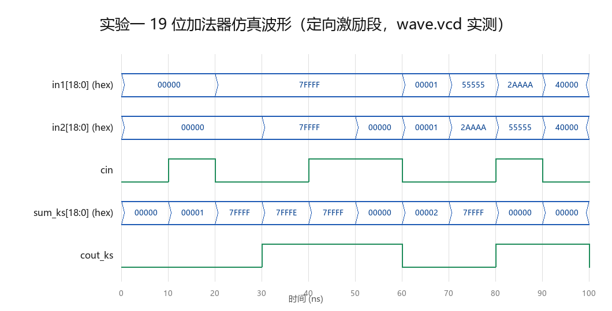

# 实验一参考手册：19 位并行前缀进位加法器

> 依据《数字电路实验手册》（Requirement/DigtalLab实验手册.docx）实验一部分编写。
> 本手册定位：**帮助学生理解原理、完成设计、通过验证、写好报告**的参考材料，
> 所有数据均来自本仓库参考实现的真实仿真/综合结果。

## 1. 实验目标与要求

| 项目 | 要求 |
| ---- | ---- |
| 任务 | 完成 **19 位并行前缀进位加法器**设计（Verilog） |
| 逻辑类型 | 组合逻辑（无时钟） |
| 模块名 | `ADDER` |
| 接口 | `in1[18:0]`、`in2[18:0]`、`cin` → `sum[18:0]`、`cout` |
| 设计空间 | Kogge–Stone / Sklansky / Brent–Kung / Han–Carlson 等任选，理解 tradeoff |

报告要求：前缀加法器原理、模块结构与关键代码、测试方法与结果、
**面积与关键路径对比（表格）**、对 PPA tradeoff 的理解。

## 2. 原理：进位问题的并行化

### 2.1 为什么串行进位慢

串行进位加法器（RCA）中，第 i 位的进位输出依赖第 i-1 位的进位输入，
N 位加法器的进位链深度为 O(N)：进位必须一级一级"涟漪"过去。
19 位就是约 19 级进位逻辑，这是全加器阵列的关键路径瓶颈。

### 2.2 生成/传播信号与前缀运算

对每一位定义：

- **生成** `g_i = a_i · b_i`（这一位自己产生进位）
- **传播** `p_i = a_i ⊕ b_i`（这一位把进位传过去）

则 `c_{i+1} = g_i + p_i · c_i`，`sum_i = p_i ⊕ c_i`。

把相邻位"合并"成块，块级 G、P 满足**前缀结合律**：

```
G' = G_hi + P_hi · G_lo      （块的生成）
P' = P_hi · P_lo             （块的传播）
```

该运算满足结合律，因此可以用**前缀计算（prefix computation）**并行求出
所有位置的进位：每个位置 i 只需要"从第 0 位到第 i 位的块 (G,P)"，
即可得 `c_{i+1} = G_{i:0} + P_{i:0} · cin`。

### 2.3 Kogge–Stone 结构

Kogge–Stone 是最规则的前缀网络：共 `⌈log2 N⌉` 级，
第 k 级每个节点 i 与距离 `2^(k-1)` 的节点 i-2^(k-1) 合并。

- 19 位 → **5 级**（2^4=16 < 19 ≤ 32=2^5）
- 优点：深度严格对数、扇出小（每个节点最多驱动 2 个）、布线极规则
- 代价：节点数较多（约 N·logN 个前缀节点），面积偏大

| 结构 | 深度 | 节点数 | 扇出 | 特点 |
| ---- | ---- | ---- | ---- | ---- |
| Kogge–Stone | logN | 多 | 2 | 最规则、最易布线，本参考实现采用 |
| Sklansky | logN | 较少 | 大（2^k） | 节点少但高扇出 |
| Brent–Kung | 2logN | 最少 | 2 | 面积最省，深度加倍 |
| Han–Carlson | logN+1 | 居中 | 居中 | Kogge 与 Brent 的折中 |

## 3. 参考实现解析

文件：[lab_1/rtl/ADDER.v](../../lab_1/rtl/ADDER.v)（Kogge–Stone）、
[lab_1/rtl/ADDER_RCA.v](../../lab_1/rtl/ADDER_RCA.v)（串行对照组）

实现分四步（对照代码注释阅读）：

1. **位级 G/P**：`g = in1 & in2; p = in1 ^ in2;`
2. **5 级前缀网络**：`generate for` 双重循环，外层级 k=1..5、内层位 i=0..18；
   `i >= 2^(k-1)` 的节点做合并，`i < 2^(k-1)` 的节点直通
3. **进位生成**：`c[i+1] = G[5][i] | (P[5][i] & cin)`，块结果与 cin 合并
4. **求和**：`sum = p ^ c[N-1:0]`，`cout = c[N]`

要点说明：

- `generate` 中的 `localparam D = 1 << (k-1)` 把级距变成**常量**，
  综合器据此生成固定连线——前缀网络本质上是纯连线+门，没有"循环计算"
- `G`/`P` 声明为 `wire [N-1:0] G [0:LEVELS]`（线网数组），
  每级一层，综合后不存在多级寄存概念
- 串行对照组 RCA 用 `generate` 例化 19 个全加器串联，作为功能与性能基准

## 4. 验证方案与结果

文件：[lab_1/tb/tb_ADDER.v](../../lab_1/tb/tb_ADDER.v)

**三方比对**：tb 同时例化 Kogge–Stone（`ADDER`）与串行（`ADDER_RCA`），
二者结果都与行为级参考 `{cout, sum} = in1 + in2 + cin` 比较。

**激励**：

| 类别 | 内容 | 目的 |
| ---- | ---- | ---- |
| 定向 10 组 | 全 0、全 1、最大值、cin=0/1、交替进位链 `0x55555/0x2AAAA`、单bit | 覆盖进位边界 |
| 随机 10000 组 | `$random` 19 位 × 2 + cin | 统计性覆盖 |

```bash
cd lab_1/sim
iverilog -g2005 -o simv ../rtl/ADDER.v ../rtl/ADDER_RCA.v ../tb/tb_ADDER.v
vvp simv        # 期望输出: Kogge-Stone: 0 errors / Ripple-Carry: 0 errors / RESULT: PASS
gtkwave wave.vcd wave.gtkw   # 可选：看波形（视图已配好）
```

实测：**10010 个向量全部正确**。

**预期终端输出**（自检基准，应逐字一致）：

```text
VCD info: dumpfile wave.vcd opened for output.
==============================================
Total vectors : 10010
Kogge-Stone   : 0 errors
Ripple-Carry  : 0 errors
RESULT: PASS
==============================================
../tb/tb_ADDER.v:103: $finish called at 100100000 (1ps)
```

**预期波形**（定向激励段 0–100 ns，每 10 ns 施加一组定向向量）：



可逐项核对：40–50 ns 处 `7FFFF+7FFFF+cin=1` → `sum=7FFFF`、`cout=1`；70–80 ns 处交替进位链 `55555+2AAAA` → `sum=7FFFF`、`cout=0`；80–90 ns 处 `2AAAA+55555+1` → `sum=00000`、`cout=1`（进位贯穿全链）。随机段 tb 执行了 `$dumpoff` 不记录波形，属设计意图。你的波形数值应与图中**逐拍一致**。

## 5. 综合结果与解读

```bash
cd lab_1/syn && yosys synth.ys   # 生成 ks_/rca_ 的 stat 与 ltp
```

| 设计 | cells（面积代理） | 最长拓扑路径 | 结论 |
| ---- | ---- | ---- | ---- |
| Kogge–Stone | **147** | **27 级** | 用 55% 额外面积换 31% 路径缩短 |
| 串行 RCA | **95** | **39 级** | 面积最省，路径随位数线性增长 |

`ks_stat.txt` 关键段落（`yosys synth.ys` 生成，全文见该文件）：

```text
=== ADDER ===
      133 wires
      147 cells
       43   $_AND_
       60   $_NAND_
       ...
```

`ks_ltp.txt` 首行：`Longest topological path in ADDER (length=27):`

> 不同版本工具链数值可能略有出入（±5% 以内可接受），但 KS「路径更短、单元更多」的相对结论必须成立，否则应检查综合脚本。

结果分析要点：

1. **理论趋势得到验证**：对数深度（log2 19 ≈ 5 级前缀 + 前后逻辑）
   显著优于线性深度（19 级全加器链）
2. **绝对数值不是理论层数**：综合器（ABC）会做全局重构、缓冲插入、
   门类型映射，27 ≠ 5、39 ≠ 19，门级路径与"理论层数"不是一一对应——
   这正是手册强调的"实际性能仍需结合综合与时序结果判断"
3. **PPA tradeoff**：Kogge–Stone 面积大而快、RCA 面积小而慢；
   若题目改考 64 位，线性 vs 对数的差距会进一步拉大（39→约 80 级，27→约 33 级）

## 6. 报告写作指导

- **原理部分**：画出 2.2 节的 G/P 合并规则 + 你选用结构的前缀网络图
  （19 位画不下可画 8 位示意，说明级数计算 `⌈log2 N⌉`）
- **结构与代码**：给出模块框图（位级 GP → 前缀网络 → 进位 → 求和四段），
  关键代码贴 generate 双重循环段即可，说明级距常量化的作用
- **对比表格**：直接测你自己的设计。格式参考第 5 节，
  建议增加"理论深度"列（log2 N 级 vs N 级）与实测值对照
- **PPA 理解**：结合 5.3，说明"没有绝对最优结构，只有特定约束下的合适选择"

## 7. 常见问题

| 问题 | 原因/解决 |
| ---- | ---- |
| iverilog 报 generate 相关语法错误 | 编译漏加 `-g2005` |
| 仿真结果全 X | tb 未给输入赋初值；或采样前没 `#1` 等组合逻辑稳定 |
| 线网数组声明报错 | `wire [18:0] G [0:5];` 是 Verilog-2001 合法语法，确认标准选项 |
| 综合后与理论层数差很多 | 正常，见 5.2；对比实验要**同流程同约束**才有意义 |
| 位宽不匹配告警 | `c[N:0]` 与 `c[N-1:0]` 切片使用处注意 20 位/19 位边界 |

## 8. 延伸思考

- 把 N 改成 32/64 参数化（`parameter N`），观察级数与资源如何变化
- 实现 Sklansky（同深度、更高扇出）或 Brent–Kung（更小面积），
  与 Kogge–Stone 做三方 PPA 对比
- 该 ADDER 将在实验二作为 Wallace 树最终求和级、实验三作为 PE 累加器复用，
  本实验成果将在实验二、三中直接复用