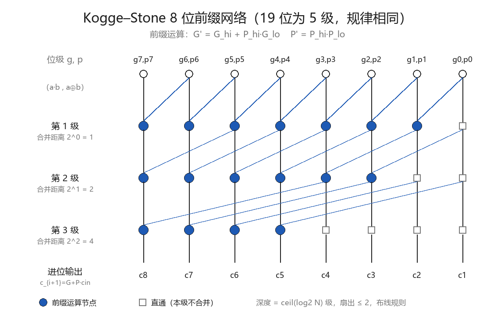
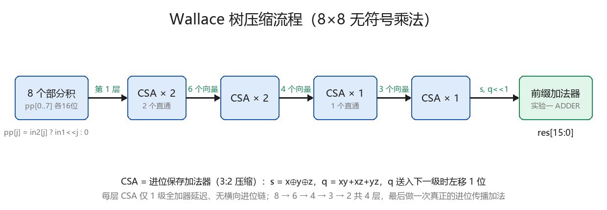
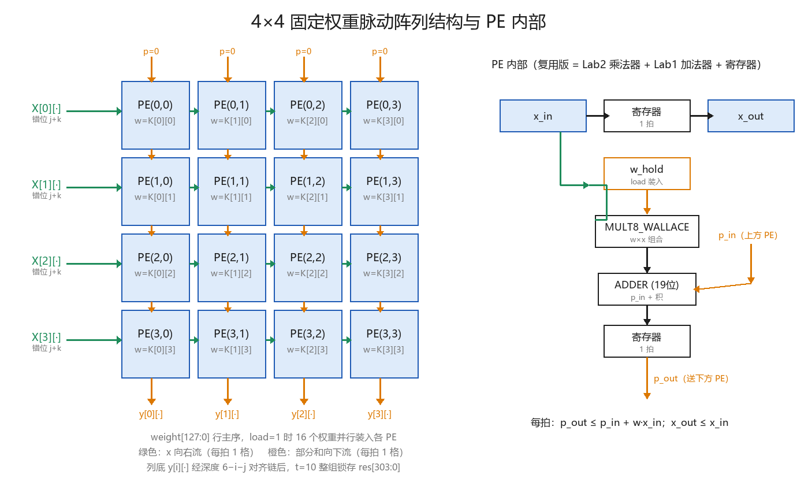
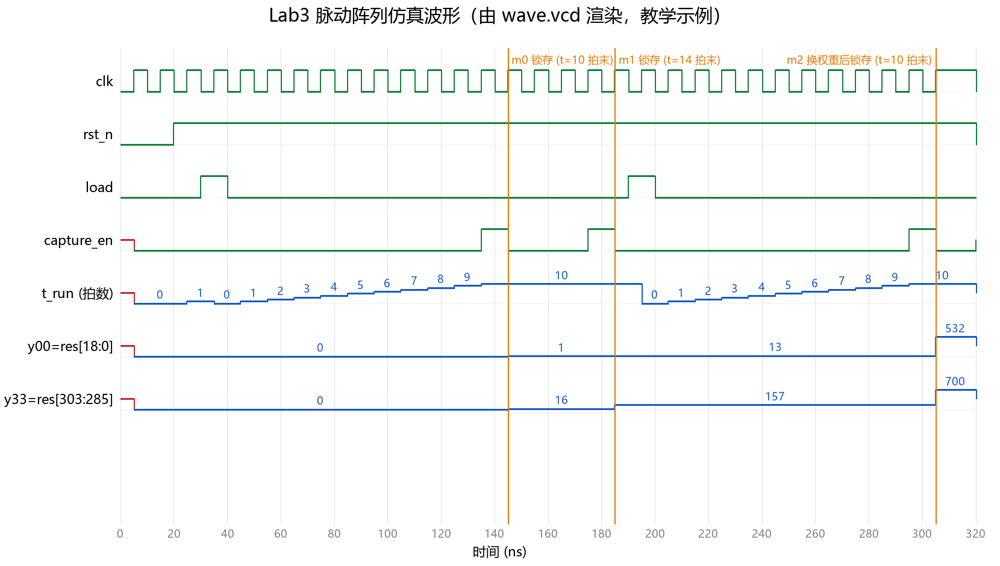

# 前言

## 手册定位

本手册是《数字电路实验》课程（2026 秋 · 41 系）三个实验的**配套参考手册**，与课程《实验手册》配合使用。课程手册规定"做什么、交什么"，本手册解决"怎么做、怎么验、怎么写"：

- **自包含**：不依赖任何外部代码仓库，完成实验所需的原理、规格、方法、关键代码与参考数据全部内嵌
- **可复现**：文中所有仿真/综合数据均来自参考实现的真实运行结果（2026-10-12，Windows 11 + Icarus Verilog + Yosys，OSS CAD Suite 1.4.0）
- **面向交付**：每章附实验报告写作要点，直接对应课程手册的报告要求

## 使用建议

1. 先读课程手册的实验任务与评估方式，再用本手册对应章节展开设计
2. 各章结构统一为：目标与要求 → 原理 → 设计规格 → 设计指导 → 验证 → 综合分析 → 报告要求 → 常见问题 → 思考拓展
3. 附录 A 为完整参考实现代码（供教师参考与学生自检对照）；建议学生先独立完成，再对照
4. 三个实验是递进路径：**加法器 → 乘法器 → 矩阵计算阵列**，后序实验直接复用前序成果，请按顺序完成

## 实验环境

| 工具 | 用途 | 安装要点 |
| ---- | ---- | ---- |
| Icarus Verilog（iverilog/vvp） | 编译与仿真 | 随 OSS CAD Suite 安装 |
| GTKWave | 波形查看 | **安装目录的 bin 与 lib 两个子目录都必须加入 PATH**（仅 bin 会因缺 DLL 启动闪退，退出码 0xC0000135） |
| Yosys | 逻辑综合 | 随 OSS CAD Suite 安装 |
| VSCode + Verilog-HDL 插件 | 代码编辑与 lint | 插件设置中 Linting 选 iverilog |

通用工作流程（各实验相同）：

```bash
iverilog -g2005 -o simv <RTL文件...> <testbench文件>   # 编译，-g2005 必须显式指定
vvp simv                                                # 仿真，终端输出 PASS/FAIL
gtkwave wave.vcd                                        # 查看波形（testbench 需 $dumpfile/$dumpvars）
yosys synth.ys                                          # 综合，产出资源统计与最长路径报告
```

> **GTKWave 提示**：打开 vcd 后默认**不加载任何信号**（空白为正常现象）。在左侧 SST 面板展开模块树，选中信号拖入波形区即可；建议选中总线后右键 Data Format → Decimal 按十进制查看。

---

# 实验一 19 位并行前缀进位加法器

## 1.1 实验目标与要求

| 项目 | 要求 |
| ---- | ---- |
| 任务 | 完成 19 位并行前缀进位加法器设计（Verilog HDL） |
| 逻辑类型 | 组合逻辑 |
| 模块名 | `ADDER` |
| 接口 | `in1[18:0]`、`in2[18:0]`、`cin` → `sum[18:0]`、`cout` |
| 设计空间 | Kogge–Stone / Sklansky / Brent–Kung / Han–Carlson 等任选，理解其 PPA tradeoff |

## 1.2 实验原理

**进位传播是加法器的瓶颈。** 串行进位加法器（RCA）中第 i 位的进位依赖第 i−1 位，N 位加法器进位链深度 O(N)。前缀加法器把进位问题转化为**前缀计算**：

对每一位定义**生成** `g_i = a_i·b_i` 与**传播** `p_i = a_i⊕b_i`，则 `c_{i+1} = g_i + p_i·c_i`，`sum_i = p_i⊕c_i`。相邻位可合并成块，块级信号满足结合律：

```
G' = G_hi + P_hi·G_lo        P' = P_hi·P_lo
```

于是可用树形前缀网络以 O(log N) 深度并行求出所有进位。**Kogge–Stone** 是最规则的前缀网络：共 ⌈log₂N⌉ 级，第 k 级每个节点 i 与距离 2^(k−1) 的节点合并，扇出不超过 2：



19 位需要 5 级（2⁴=16 < 19 ≤ 32=2⁵）。常见结构对比：

| 结构 | 深度 | 节点数 | 最大扇出 | 特点 |
| ---- | ---- | ---- | ---- | ---- |
| Kogge–Stone | log N | 较多 | 2 | 最规则、易布线，本手册参考实现采用 |
| Sklansky | log N | 较少 | 2^k | 节点省但高扇出 |
| Brent–Kung | 2 log N | 最少 | 2 | 面积最省、深度加倍 |
| Han–Carlson | log N + 1 | 居中 | 居中 | 前两者折中 |

## 1.3 设计规格

```
module ADDER(
    input  wire [18:0] in1,
    input  wire [18:0] in2,
    input  wire        cin,
    output wire [18:0] sum,
    output wire        cout
);
```

纯组合逻辑，无任何时钟/复位。建议同时实现一个串行加法器作为对照组（功能交叉验证 + PPA 对比素材）。

## 1.4 设计指导与关键代码

实现分四段：位级 G/P → 前缀网络 → 进位生成 → 求和。前缀网络用 `generate` 双重循环描述，**级距用 localparam 常量化**，综合器据此生成固定连线：

```verilog
generate
    for (k = 1; k <= LEVELS; k = k + 1) begin : g_level
        localparam integer D = 1 << (k - 1);       // 本级合并距离：1,2,4,8,16
        for (i = 0; i < N; i = i + 1) begin : g_bit
            if (i >= D) begin : g_calc              // 前缀运算节点
                assign G[k][i] = G[k-1][i] | (P[k-1][i] & G[k-1][i-D]);
                assign P[k][i] = P[k-1][i] & P[k-1][i-D];
            end
            else begin : g_pass                     // 直通节点
                assign G[k][i] = G[k-1][i];
                assign P[k][i] = P[k-1][i];
            end
        end
    end
endgenerate
```

进位与求和（注意 cin 的合并位置——在全部前缀结果之后做一次）：

```verilog
assign c[0] = cin;
assign c[N:1] = G[LEVELS] | (P[LEVELS] & {N{cin}});
assign sum = p ^ c[N-1:0];
assign cout = c[N];
```

完整代码见附录 A.1。

## 1.5 验证方法与参考结果

**三方比对策略**：testbench 同时例化前缀加法器与串行加法器，两者都与行为级参考 `{cout,sum} = in1+in2+cin` 比对，任一不一致即报错。

| 激励类别 | 内容 | 覆盖目的 |
| ---- | ---- | ---- |
| 定向 10 组 | 全 0、全 1、最大值、cin=0/1、交替进位链 0x55555/0x2AAAA、单 bit | 进位边界与最坏传播 |
| 随机 10000 组 | $random | 统计覆盖 |

参考运行结果：

```
Kogge-Stone: 0 errors / 10010 vectors
Ripple-Carry: 0 errors / 10010 vectors
RESULT: PASS
```

自检型 testbench 要点（完整代码见附录 A.1）：组合逻辑激励后 `#1` 再采样；比对用 `!==`（X/Z 也判错）；出错打印现场（输入、期望、实际）。

## 1.6 综合对比与结果分析

综合脚本（synth.ys）关键行：`synth -top ADDER -flatten; stat; ltp`。实测（同流程同约束）：

| 设计 | cells（面积代理） | 最长拓扑路径 | 理论深度 |
| ---- | ---- | ---- | ---- |
| Kogge–Stone | 147 | 27 级 | ⌈log₂19⌉=5 级前缀 + 前后逻辑 |
| 串行 RCA | 95 | 39 级 | 19 级全加器链 |

**解读**（报告可直接展开）：

1. 理论趋势得到验证：对数深度显著优于线性深度，路径缩短 31%，代价是面积增加 55%——典型的 PPA tradeoff
2. 实测级数 ≠ 理论层数：ABC 综合器对逻辑做全局重构与缓冲插入，"5 级前缀"在门级网表中不逐层对应；理论给出**趋势**，数值必须实测
3. 位宽越大差距越悬殊：若扩展至 64 位，线性链约 80 级而对数结构仅约 33 级

> **流程坑**：必须 `synth -flatten`（先整平再映射），让 ABC 跨模块全局优化；若 `synth` 后再 `flatten`，关键路径数据会明显失真。

## 1.7 实验报告要求（对照课程手册）

1. 前缀进位加法器设计原理：给出 G/P 定义、前缀合并公式、所选结构的网络图与级数计算
2. 模块结构与关键代码：四段式框图 + generate 网络核心代码
3. 测试方法与结果：激励表 + PASS 证据（可附波形）
4. 面积与关键路径对比（表格）：参考 1.6 格式，须同流程实测
5. PPA tradeoff 理解：结合数据讨论"没有绝对最优，只有特定约束下的合适选择"

## 1.8 常见问题

| 问题 | 原因与解决 |
| ---- | ---- |
| generate 相关语法报错 | 编译漏加 `-g2005` |
| 仿真结果全 X | 激励未赋初值，或采样前未 `#1` 等组合逻辑稳定 |
| 线网数组声明报错 | `wire [18:0] G [0:5];` 为 Verilog-2001 合法语法，检查编译标准 |
| 综合级数与理论不符 | 正常（见 1.6）；确认使用了 `synth -flatten` |
| 位宽告警 | 注意 20 位进位向量 `c[19:0]` 与 19 位切片边界 |

## 1.9 思考与拓展

- 参数化位宽（`parameter N`），观察级数与资源随 N 的变化规律
- 实现 Sklansky 或 Brent–Kung，三方 PPA 对比（报告加分素材）
- 本 ADDER 将在实验二做 Wallace 树最终求和级、实验三做 PE 累加器——做扎实即为后续铺路

---

# 实验二 8 位移位相加乘法器（Wallace 树）

## 2.1 实验目标与要求

| 项目 | 要求 |
| ---- | ---- |
| 任务 | 完成 8 位无符号整数移位相加乘法器（Verilog HDL，组合逻辑） |
| 部分积相加 | **华莱士树（Wallace Tree）**结构 |
| 最终求和 | 压缩所得的 2 个部分和，**采用实验一设计的并行前缀进位加法器**完成 |
| 模块名 | `MULT` |
| 接口 | `in1[7:0]`、`in2[7:0]` → `res[15:0]` |

## 2.2 实验原理

**移位相加产生 8 个部分积**：`res = Σⱼ (in2[j] ? (in1<<j) : 0)`，j=0..7，每个 16 位。朴素连加需 7 个加法器串联，深度线性。

**进位保存加法器（CSA）**是 Wallace 树的压缩砖——3:2 压缩器：

```
s = x ⊕ y ⊕ z          （和，留本列）
q = xy + xz + yz       （进位，送入下一级时左移 1 位）
x + y + z = s + (q<<1)
```

关键性质：**各位独立、无横向进位链**，无论多宽都只有 1 级全加器延迟。进位不立即传播，而是"保存"下来逐层压缩：



8 个部分积经 **4 层 CSA**（8→6→4→3→2）压到 2 个向量，最后用实验一的前缀加法器做一次真正的进位传播加法。深度从线性（7 个加法器）降为对数级压缩 + 1 次快速加法。

## 2.3 设计规格

```
module MULT(
    input  wire [7:0]  in1,
    input  wire [7:0]  in2,
    output wire [15:0] res
);
```

建议模块层次：`MULT`（顶层包装）→ `MULT8_WALLACE`（压缩核心）→ `CSA` ×7 + `ADDER`（实验一）。另实现一个朴素连加版本作对照。

## 2.4 设计指导与关键代码

**CSA 模块**（参数化，注意输出是**未左移**的原始进位 q）：

```verilog
module CSA #(parameter W = 16) (
    input  wire [W-1:0] x, y, z,
    output wire [W-1:0] s,      // 和（本列）
    output wire [W-1:0] q       // 进位（未左移，下级送入时 <<1）
);
    assign s = x ^ y ^ z;
    assign q = (x & y) | (x & z) | (y & z);
endmodule
```

**部分积生成**（零扩展到 16 位）：

```verilog
for (j = 0; j < 8; j = j + 1) begin : g_pp
    assign pp[j] = in2[j] ? ({8'b0, in1} << j) : 16'b0;
end
```

**压缩层连接**（第 1 层示例；左移在送入下一级时完成）：

```verilog
CSA #(16) csa0 (.x(pp[0]), .y(pp[1]), .z(pp[2]), .s(s1), .q(q1));
// 下一级使用 q1 时：{q1[14:0], 1'b0}
```

**最易错的三点**：

1. `q` 必须左移 1 位才有效（经典错误：忘记左移导致结果差一倍）
2. 每层没被压缩的向量（如第 1 层的 pp[6]、pp[7]）要**直通**到下一层
3. 最终加法：s 与 q<<1 零扩展到 19 位送实验一 ADDER，`cin=0`，取 `sum[15:0]`；`cout` 理论恒 0 可用于自检

**压缩过程表**（报告要求，可直接核对）：

| 层 | 输入向量数 | CSA 配置 | 输出向量数 |
| ---- | ---- | ---- | ---- |
| 1 | 8 | 2 个 CSA，2 个直通 | 6 |
| 2 | 6 | 2 个 CSA | 4 |
| 3 | 4 | 1 个 CSA，1 个直通 | 3 |
| 4 | 3 | 1 个 CSA | 2 |

完整代码见附录 A.2。

## 2.5 验证方法与参考结果

**全量遍历**：8×8 输入空间仅 65536 组，仿真秒级完成——小位宽电路优先穷举，这是功能正确性的最强证据。testbench 内置 `res === a*b` 自检，另加 9 组定向用例（0×0、255×255、128×2 等）。

参考运行结果：

```
Directed + Exhaustive: 65536 vectors
Errors: 0
RESULT: PASS
```

（Wallace 版与朴素版两个 DUT 同时通过。）

## 2.6 综合对比与结果分析

| 设计 | cells | 最长拓扑路径 | 理论结构 |
| ---- | ---- | ---- | ---- |
| Wallace 树 | 381 | 28 级 | 4 层 CSA + 前缀加法 |
| 朴素连加 | 338 | 37 级 | 7 个加法器串联 |

**思考题（理论层数与实际性能的关系）参考分析**：

1. 趋势一致：Wallace 路径短 24%、面积多 13%，面积换速度成立
2. 绝对级数不等于理论层数：ABC 全局重构（与/或/异或重新分解、缓冲插入）后，"4 层 CSA"在门级网表中已不可逐层辨认
3. 结论呼应课程手册："较少的理论层数并不保证在所有工艺或 FPGA 上都更快"——理论给趋势，数值靠实测；位宽越大（如 32×32）Wallace 优势越显著

## 2.7 实验报告要求（对照课程手册）

1. 设计原理：部分积阵列图 + CSA 公式 + 压缩过程表（2.4）
2. 模块结构与关键代码：层次图 + CSA/压缩层/最终加法接口说明
3. 测试方法与结果：穷举策略与 PASS 证据
4. 面积与关键路径对比（表格）：参考 2.6，同流程实测
5. PPA tradeoff 理解；思考理论层数与实际综合结果的关系（参考 2.6 分析框架）
6. 可能的改进：4-2 压缩器、Booth 编码减半部分积、流水线化等（任选展开）

## 2.8 常见问题

| 问题 | 原因与解决 |
| ---- | ---- |
| 结果总是差一倍/两倍 | q 忘记（或重复）左移 1 位 |
| 大数错、小数对 | 部分积未零扩展到 16 位，移位被截断 |
| LTP 异常偏大 | synth 脚本缺 `-flatten` |
| Unknown module: ADDER | 编译漏带实验一的 ADDER.v（本实验直接复用） |
| 穷举仿真很慢 | 正常约数秒；检查是否每向量都 $display（应只在出错时打印） |

## 2.9 思考与拓展

- 把最终加法器分别换成 RCA / Kogge–Stone，量化最终级对整体的影响
- 调研 4-2 压缩器（5:3）与 Booth 编码，估算层数与部分积数量的收益
- 本乘法器将在实验三（复用版）作为 PE 的乘法单元——保持接口稳定、位宽可参数化

---

# 实验三 全流水脉动阵列矩阵乘法器

## 3.1 实验目标与要求

| 项目 | 要求 |
| ---- | ---- |
| 任务 | 设计 4×4 **全流水脉动阵列**，计算两个 4×4 无符号 8 位整数矩阵之积 |
| PE 结构 | **固定权重（Weight-Stationary）**：PE 保存一个权重，输入从左流入，部分和从上流入 |
| 工作模式 | `load=1` 停止计算并装载权重；`load=0` 正常计算 |
| 模块名 | `MULT` |
| 接口 | `input[127:0]`、`weight[127:0]`、`clk`、`rst_n`、`load` → `res[303:0]` |
| 输出位宽 | 单元素 19 位（最大值 4×255×255=260100 < 2¹⁸），`res[19*(4i+j) +: 19] = y_ij` |

> `input` 是 Verilog 关键字，端口必须改名（参考实现用 `input_data`）。

## 3.2 实验原理

脉动阵列（Systolic Array，Kung & Leiserson 1978，参考文献 [1]）让数据在规则排列的 PE 间**按拍流动**：权重驻留 PE 内，输入每拍向右传一格，部分和每拍向下传一格并沿途累加。全部连接都是相邻 PE 的局部短线，无全局总线——这使它成为 TPU 等 AI 芯片的核心结构 [2][3]。

下图（参考资料 [3] 原图）给出一维权重固定阵列的逐拍过程：权重 w₁..w₃ 驻留，x 依次流入，部分和随流动逐级累加，y₁、y₂ 依次在末端流出：

![图 3-1 权重固定阵列逐拍数据流（图源：telesens.co，参考文献 [3]）](images/external/telesens_ws_1d_pe.png)

扩展到二维矩阵乘：权重按网格驻留，**输入按对角线错位注入**（下图，参考资料 [3] 原图），结果元素在列底按波前依次出现，总延迟 2N−1+M 拍量级：

![图 3-2 二维权重固定阵列的错位注入与输出时刻（图源：telesens.co，参考文献 [3]）](images/external/telesens_ws_2d_matmul.png)

PE 内部时序（课程手册给定，必须遵守）：

| 时钟 | x_in | p_in | p_out |
| ---- | ---- | ---- | ---- |
| 1 | x₁ | p₁ | 0 |
| 2 | x₂ | p₂ | p₁ + w·x₁ |
| 3 | x₃ | p₃ | p₂ + w·x₂ |

即 `p_out ≤ p_in + w·x_in`、`x_out ≤ x_in`，均寄存 1 拍。

## 3.3 设计规格与数据约定

**接口**（`input` 改名 `input_data`）：

```
module MULT(
    input  wire         clk, rst_n, load,
    input  wire [127:0] input_data,
    input  wire [127:0] weight,
    output reg  [303:0] res
);
```

**总线编码约定**（本手册规定，演示与验收以此为准）：

| 总线 | 位段 | 含义 |
| ---- | ---- | ---- |
| `weight[127:0]` | `[8*(4i+k) +: 8]` | 权重 K[i][k]，行主序；load=1 时 16 个权重并行装入各 PE |
| `input_data[127:0]` | `[8*(4q+k) +: 8]` | 帧槽位 (4q+k)：第 t=4f+q 拍出现在第 k 行左边界的输入元素 |
| `res[303:0]` | `[19*(4i+j) +: 19]` | 结果 y_ij，行主序；t=4m+10 拍整组锁存 |

**输入按"帧"驱动**：一帧 4 拍喂完 16 个槽位，驱动端按 3.4 节错位规则预先排布（帧 f 槽位 (4q+k) 的内容由 `4m+j = 4f+q−k` 反推，越界填 0）。这一"错位逻辑放在驱动端、阵列保持简单"的划分，是一种合理且易验的设计决策。

## 3.4 完整时序推导（报告核心）

设 load 拉低后的拍号为 t（0 起），矩阵 m 的注入窗口为 t∈[4m, 4m+6]：

1. **注入（对角错位）**：X[k][j] 必须在 `t = 4m+j+k` 拍出现在第 k 行左边界。同行 j 递增 1 拍一个；行间 k 递增再错 1 拍——x 每向右一格晚 1 拍、部分和每向下一格也晚 1 拍，错位 j+k 保证 X[k][j] 在第 i 列恰好与 K[i][k] 相遇
2. **阵列内传播**：X[k][j] 于 `t = 4m+j+k+i` 拍到达 PE(k,i)，该拍该 PE 累加 K[i][k]·X[k][j]
3. **列底出现**：部分和再向下 (4−k) 级（各 1 拍），y_ij 于 `t = 4m+i+j+4` 拍出现在第 i 列底部
4. **输出对齐**：y_ij 出现时刻 i+j+4 各不相同（4m+4 到 4m+10），对 y_ij 施加深度 **6−i−j** 的延迟链后，16 个结果在 `t = 4m+10` 拍整组对齐，统一锁存 `res`
5. **连续流水**：矩阵 m+1 自 t=4m+4 拍起注入（窗口重叠）——**启动间隔 II=4 拍**（每 4 拍一个矩阵，达理论峰值），**单矩阵延迟 10 拍**，稳态吞吐 16 MAC/拍（16 个 PE 全满载）
6. **换权重**：load=1 装入新权重的同时**清空全部流水寄存器**，旧计算作废（课程手册明确警告：不清除则旧部分和混入新权重计算）。代价是重新灌注约 10 拍——连续换权重场景吞吐显著下降

## 3.5 参考实现结构



顶层结构：节拍计数（phase/t_run）→ 4×4 PE 阵列（generate 双重循环）→ 行输入帧选择 → 列底对齐延迟链 → 捕获整组锁存。关键代码：

```verilog
// 捕获门控：t_run 计到 10 后饱和；t_run==10 且拍相位 2 时整组锁存
wire cap_en = load_seen && t_run[3:0] == 4'd10 && phase == 2'd2;

// 输出对齐：y_ij 经深度 6-i-j 的打拍链
genvar i, j;
generate
  for (i = 0; i < 4; i = i + 1) begin : g_col
    for (j = 0; j < 4; j = j + 1) begin : g_out
      localparam integer DEPTH = 6 - i - j;      // 0..6 级对齐延迟
      ...
    end
  end
endgenerate
```

**PE（复用版）= 实验二乘法器 + 实验一加法器 + 3 个寄存器**：

```verilog
wire [15:0] prod;
MULT8_WALLACE u_mult (.in1(w_hold), .in2(x_in), .res(prod));   // 实验二
wire [18:0] psum;
ADDER u_add (.in1(p_in), .in2({3'b0, prod}), .cin(1'b0),
             .sum(psum), .cout());                              // 实验一
always @(posedge clk or negedge rst_n) begin
    if (!rst_n)      begin w_hold <= 0; x_out <= 0; p_out <= 0; end
    else if (load)   begin w_hold <= w_in; x_out <= 0; p_out <= 0; end  // 装权重 + 清流水
    else             begin x_out <= x_in; p_out <= psum; end
end
```

**双版本说明**：本实验提供两种等价实现，接口、时序、testbench 完全一致——

| | 复用版 | 独立版 |
| ---- | ---- | ---- |
| PE 乘加 | 结构实例化实验二 MULT8_WALLACE + 实验一 ADDER | 行为级 `p_in + w_hold * x_in`（一句 always） |
| 适用 | 已完成实验一、二（体现课程连贯路径） | 仅做实验三、或追求代码最简 |
| 综合（实测） | 8547 cells / 37 级 | 7709 cells / 38 级 |

两版差异仅 PE 内部；行为级写法把优化自由度让给综合器（面积略省 3%），结构级写法把微架构控制权留在设计者手里。完整代码见附录 A.3/A.4。

## 3.6 验证方法与参考结果

testbench 内置黄金模型（`Y=K·X` 按 19 位截断计算）与帧打包器（pack_frame 任务实现 3.3 节错位映射），自动比对 res 的 16 个字段。三个场景缺一不可：

| 场景 | 内容 | 检查点 | 验证目标 |
| ---- | ---- | ---- | ---- |
| 单发 | K1=单位矩阵，X0=1..16 | t=10 | Y=X0 肉眼可核对，验证基本数据流 |
| II=4 连续流水 | X0、X1 背靠背注入 | t=10 与 **t=14** | 窗口重叠下两组结果互不污染 |
| 换权重 | load 装入 K2 后算 X2 | t=10 | 旧部分和被彻底清除 |

参考运行结果：

```
[CHECK m0] Y[0][0]=1 ... [CHECK m1] @t=14 ... [CHECK m2] Y=K2*X2
Errors: 0
RESULT: PASS
```

实际仿真波形（clk/rst_n/load/捕获使能/节拍计数/两个角点输出，三个锁存时刻已标注）：



读图：load 装入 K1（单位阵）后 t_run 逐拍计数，第 10 拍末 y00: 0→1、y33: 0→16（Y=X0 ✓）；第二个矩阵紧跟流水，t=14 拍末更新为 X1 的结果；第二次 load 换 K2，旧值清空，t=10 拍末得 K2·X2。

## 3.7 综合对比与结果分析

| 版本 | cells | 最长拓扑路径 | 说明 |
| ---- | ---- | ---- | ---- |
| 复用版 | 8547 | 37 级（单拍） | = 单 PE 内"Wallace 乘法 + Kogge–Stone 加法"路径 |
| 独立版 | 7709 | 38 级（单拍） | ABC 对行为级 * / + 自由重构 |

**报告分析框架**（吞吐/延迟/面积）：

1. **频率**：流水寄存器把关键路径限制在单个 PE 的乘加内，**与阵列规模无关**——扩到 16×16 理论路径几乎不变，这就是脉动阵列的可扩展性
2. **吞吐/延迟**：II=4 拍、延迟 10 拍、峰值 16 MAC/拍（3.4-5）
3. **面积**：约 1200 个触发器（16 PE × 35 bit + 对齐链 + res 寄存器组），流水寄存器占相当比例——全流水的面积代价

## 3.8 实验报告要求（对照课程手册）

1. 数据流与 PE/阵列结构说明：PE 图（w 驻留、x 右流、p 下流）+ 4×4 阵列连接图，说明局部连接特性（图 3-3 可作为画法参考）
2. 完整时序推导：按 3.4 的 ①→⑥ 展开，给出 t=0..14 逐拍表（哪拍哪个 PE 算哪个元素、y_ij 何时到列底、何时锁存）
3. 吞吐率/延迟/面积分析：区分**单矩阵延迟**与**稳态吞吐**（3.7 框架）
4. 优化设计（自己的思考）：如输入侧错位寄存器阵列（把帧打包移入片内）、阵列参数化、输出站（output-stationary）变体（参考资料 [3] 有对照设计，见 3.10）、稀疏零值门控降功耗等

**演示准备**（评估含现场演示）：

1. 准备可口算验证的矩阵（单位阵、全 1、对角阵），能讲清每拍数据位置
2. "第 5 拍 PE(2,1) 在算什么"类问题：用 `t = 4m+j+k+i` 反查
3. 吞吐率：II=4、16 MAC/拍；换权重代价：load 清流水 + 重新灌注约 10 拍，能定量说明有效吞吐下降即为加分

## 3.9 常见问题

| 问题 | 原因与解决 |
| ---- | ---- |
| 换权重后结果混入旧值 | load 时未清空流水寄存器（课程手册明确警告的坑） |
| 结果整体错位/串行 | 注入未按 j+k 对角错位；检查帧映射 `4m+j = 4f+q−k` |
| input 相关编译错误 | `input` 是关键字，端口改名 input_data |
| 首组对、后续全错 | 节拍计数（phase/t_run）未在 load 时清零 |
| 输出全 X | 复位时序：rst_n 先拉低 ≥2 拍再释放；所有寄存器需复位分支 |
| 输出永远不更新 | 捕获门控拍号与理论推导不符——先完成 3.4 推导再编码 |

## 3.10 思考与拓展

脉动阵列的设计空间远不止本实验一种形态。Kung 原始论文中的三种卷积阵列设计（参考资料 [3] 整理）在"PE 复杂度 vs 利用率/吞吐/延迟"上各有取舍：

![图 3-5 Kung 的三种脉动设计权衡（图源：telesens.co，参考文献 [3]）](images/external/telesens_kung_designs.png)

连续多矩阵时的输出波前与读出周期公式 N(B+1)−1（B 为矩阵批数）：

![图 3-6 批量矩阵的输出波前与周期公式（图源：telesens.co，参考文献 [3]）](images/external/telesens_output_schedule.png)

作为对比，**输出站（output-stationary）**变体让数据流过 PE、结果留在原地累加（权重顺序需反转）——与本实验的权重固定形成设计空间的两端：

![图 3-7 输出站变体：数据流过、结果驻留（图源：telesens.co，参考文献 [3]）](images/external/telesens_output_stationary.png)

- 把阵列参数化（`parameter N`），推导 N×N 时 II、延迟与对齐深度的通式，并与上图公式对照
- 对照 Google TPU（256×256，参考文献 [2]）分析数据复用模式与带宽需求如何随规模变化：

![图 3-8 Google TPU 框图，Matrix Multiply Unit 即 256×256 脉动阵列（图源：telesens.co，参考文献 [3]）](images/external/telesens_tpu.png)

- 面向 attention 类"操作数随输入变化"的任务（课程手册结语），固定权重的复用假设何时失效？

---

# 附录 A 参考实现完整代码

> 本附录为三个实验的完整参考实现（已通过全部仿真验证与综合），供教师参考与学生自检对照。
> 建议学生独立完成设计后再比对；若接口约定与本手册 3.3 节不同但自洽，同样 acceptable。

## A.1 实验一

**ADDER.v（Kogge–Stone 前缀加法器）**：

```verilog
`timescale 1ns/1ps
module ADDER(
    input  wire [18:0] in1,
    input  wire [18:0] in2,
    input  wire        cin,
    output wire [18:0] sum,
    output wire        cout
);
    localparam integer N      = 19;
    localparam integer LEVELS = 5;             // ceil(log2(19))

    wire [N-1:0] g = in1 & in2;                // 位级生成
    wire [N-1:0] p = in1 ^ in2;                // 位级传播

    wire [N-1:0] G [0:LEVELS];                 // 各级块生成/传播
    wire [N-1:0] P [0:LEVELS];
    assign G[0] = g;
    assign P[0] = p;

    genvar k, i;
    generate
        for (k = 1; k <= LEVELS; k = k + 1) begin : g_level
            localparam integer D = 1 << (k - 1);
            for (i = 0; i < N; i = i + 1) begin : g_bit
                if (i >= D) begin : g_calc
                    assign G[k][i] = G[k-1][i] | (P[k-1][i] & G[k-1][i-D]);
                    assign P[k][i] = P[k-1][i] & P[k-1][i-D];
                end
                else begin : g_pass
                    assign G[k][i] = G[k-1][i];
                    assign P[k][i] = P[k-1][i];
                end
            end
        end
    endgenerate

    wire [N:0] c;
    assign c[0]   = cin;
    assign c[N:1] = G[LEVELS] | (P[LEVELS] & {N{cin}});
    assign sum    = p ^ c[N-1:0];
    assign cout   = c[N];
endmodule
```

**ADDER_RCA.v（串行对照组）**：

```verilog
`timescale 1ns/1ps
module ADDER_RCA(
    input  wire [18:0] in1,
    input  wire [18:0] in2,
    input  wire        cin,
    output wire [18:0] sum,
    output wire        cout
);
    wire [19:0] c;
    assign c[0] = cin;
    genvar i;
    generate
        for (i = 0; i < 19; i = i + 1) begin : g_fa
            assign sum[i] = in1[i] ^ in2[i] ^ c[i];
            assign c[i+1] = (in1[i] & in2[i]) | (in1[i] & c[i]) | (in2[i] & c[i]);
        end
    endgenerate
    assign cout = c[19];
endmodule
```

**tb_ADDER.v（自检 testbench 骨架与关键段）**：

```verilog
`timescale 1ns/1ps
module tb_ADDER;
    reg  [18:0] in1, in2;
    reg         cin;
    wire [18:0] sum_ks, sum_rca;
    wire        cout_ks, cout_rca;
    integer     errors = 0, i;

    ADDER     u_ks  (.in1(in1), .in2(in2), .cin(cin), .sum(sum_ks),  .cout(cout_ks));
    ADDER_RCA u_rca (.in1(in1), .in2(in2), .cin(cin), .sum(sum_rca), .cout(cout_rca));

    reg [19:0] ref;
    task check;
        begin
            #1;                                   // 等组合逻辑稳定
            ref = in1 + in2 + cin;                // 行为级黄金参考
            if ({cout_ks, sum_ks} !== ref) begin
                errors = errors + 1;
                $display("[ERROR-KS] in1=%h in2=%h cin=%b | expected=%h got=%h",
                         in1, in2, cin, ref, {cout_ks, sum_ks});
            end
            if ({cout_rca, sum_rca} !== ref) begin
                errors = errors + 1;
                $display("[ERROR-RCA] ...");
            end
        end
    endtask

    initial begin
        $dumpfile("wave.vcd"); $dumpvars(0, tb_ADDER);
        in1=0; in2=0; cin=0; check;               // 定向：全0
        in1=19'h7FFFF; in2=19'h7FFFF; cin=1; check; // 最大值+进位
        in1=19'h55555; in2=19'h2AAAA; cin=0; check; // 交替进位链
        // ... 其余定向用例 ...
        for (i = 0; i < 10000; i = i + 1) begin   // 随机 10000 组
            in1 = $random; in2 = $random; cin = $random & 1;
            check;
        end
        if (errors == 0) $display("RESULT: PASS");
        else             $display("RESULT: FAIL (%0d errors)", errors);
        $finish;
    end
endmodule
```

## A.2 实验二

**CSA.v（完整）**：

```verilog
`timescale 1ns/1ps
module CSA #(parameter W = 16) (
    input  wire [W-1:0] x, y, z,
    output wire [W-1:0] s,
    output wire [W-1:0] q       // 未左移原始进位
);
    assign s = x ^ y ^ z;
    assign q = (x & y) | (x & z) | (y & z);
endmodule
```

**MULT8_WALLACE.v（压缩核心）**：

```verilog
`timescale 1ns/1ps
module MULT8_WALLACE(
    input  wire [7:0]  in1,
    input  wire [7:0]  in2,
    output wire [15:0] res
);
    wire [15:0] pp [0:7];
    genvar j;
    generate
        for (j = 0; j < 8; j = j + 1) begin : g_pp
            assign pp[j] = in2[j] ? ({8'b0, in1} << j) : 16'b0;
        end
    endgenerate

    // 第 1 层：8 -> 6
    wire [15:0] s11, q11, s12, q12;
    CSA #(16) csa11 (.x(pp[0]), .y(pp[1]), .z(pp[2]), .s(s11), .q(q11));
    CSA #(16) csa12 (.x(pp[3]), .y(pp[4]), .z(pp[5]), .s(s12), .q(q12));
    // pp[6], pp[7] 直通

    // 第 2 层：6 -> 4
    wire [15:0] s21, q21, s22, q22;
    CSA #(16) csa21 (.x(s11), .y({q11[14:0],1'b0}), .z(s12),            .s(s21), .q(q21));
    CSA #(16) csa22 (.x({q12[14:0],1'b0}), .y(pp[6]), .z(pp[7]),        .s(s22), .q(q22));

    // 第 3 层：4 -> 3
    wire [15:0] s31, q31;
    CSA #(16) csa31 (.x(s21), .y({q21[14:0],1'b0}), .z(s22),            .s(s31), .q(q31));
    // {q22[14:0],1'b0} 直通

    // 第 4 层：3 -> 2
    wire [15:0] s41, q41;
    CSA #(16) csa41 (.x(s31), .y({q31[14:0],1'b0}), .z({q22[14:0],1'b0}), .s(s41), .q(q41));

    // 最终进位传播加法：实验一 ADDER（19 位，cin=0）
    wire [18:0] fsum; wire fcout;
    ADDER u_final (.in1({3'b000, s41}), .in2({2'b00, q41, 1'b0}),
                   .cin(1'b0), .sum(fsum), .cout(fcout));
    assign res = fsum[15:0];
endmodule
```

**MULT.v（顶层包装）**：仅例化 `MULT8_WALLACE` 并对外提供手册要求的接口。**MULT_NAIVE.v（对照组）**：7 个部分积用 `{res} = pp0+pp1+...+pp7` 行为级连加或加法器链实现。**tb_MULT.v**：定向 9 组 + 双重 for 全量遍历 65536 组，`res !== (a*b)` 计数报错（骨架同 A.1 风格）。

## A.3 实验三（复用版）

**PE.v（完整）**：

```verilog
`timescale 1ns/1ps
module PE(
    input  wire        clk,
    input  wire        rst_n,
    input  wire        load,
    input  wire [7:0]  w_in,
    input  wire [7:0]  x_in,
    input  wire [18:0] p_in,
    output reg  [7:0]  x_out,
    output reg  [18:0] p_out
);
    reg  [7:0]  w_hold;
    wire [15:0] prod;
    MULT8_WALLACE u_mult (.in1(w_hold), .in2(x_in), .res(prod));
    wire [18:0] psum;
    ADDER u_add (.in1(p_in), .in2({3'b000, prod}), .cin(1'b0), .sum(psum), .cout());

    always @(posedge clk or negedge rst_n) begin
        if (!rst_n) begin
            w_hold <= 8'd0; x_out <= 8'd0; p_out <= 19'd0;
        end else if (load) begin
            w_hold <= w_in;               // 装入权重
            x_out  <= 8'd0;               // 同时清空流水（关键！）
            p_out  <= 19'd0;
        end else begin
            x_out <= x_in;
            p_out <= psum;
        end
    end
endmodule
```

**MULT.v（顶层，关键段）**：

```verilog
// ---- 节拍计数 ----
reg [1:0] phase;                 // 0..3 帧内拍
reg [3:0] t_run;                 // 计到 10 后饱和
reg       load_seen;
always @(posedge clk or negedge rst_n) begin
    if (!rst_n) begin phase <= 0; t_run <= 0; load_seen <= 0; end
    else if (load) begin phase <= 0; t_run <= 0; load_seen <= 1; end
    else begin
        phase <= phase + 2'd1;
        if (t_run != 4'd15 && t_run < 4'd11) t_run <= t_run + 4'd1; // 0..10, 之后保持
    end
end
wire cap_en = load_seen && (t_run == 4'd10) && (phase == 2'd2);

// ---- 行输入帧选择：第 phase 拍把槽位 (4*phase+k) 送到第 k 行 ----
wire [7:0] row_x [0:3];
genvar k;
generate for (k = 0; k < 4; k = k + 1) begin : g_rowin
    assign row_x[k] = input_data[8*(4*phase + k) +: 8];
end endgenerate

// ---- 4×4 PE 阵列（权重行主序：PE(k,i) 装 K[i][k]）----
genvar i;
generate
  for (k = 0; k < 4; k = k + 1) begin : g_row
    for (i = 0; i < 4; i = i + 1) begin : g_col
      wire [7:0]  xi, xo;
      wire [18:0] pi, po;
      if (i == 0) assign xi = row_x[k];
      else        assign xi = g_row[k].g_col[i-1].xo;
      if (k == 0) assign pi = 19'd0;
      else        assign pi = g_row[k-1].g_col[i].po;
      PE u_pe (.clk(clk), .rst_n(rst_n), .load(load),
               .w_in(weight[8*(4*i+k) +: 8]),
               .x_in(xi), .p_in(pi), .x_out(xo), .p_out(po));
    end
  end
endgenerate

// ---- 列底输出对齐：y_ij 打拍深度 6-i-j，cap_en 整组锁存 ----
generate
  for (i = 0; i < 4; i = i + 1) begin : g_oc
    for (j = 0; j < 4; j = j + 1) begin : g_oe
      localparam integer DEPTH = 6 - i - j;
      reg [18:0] dl [0:5];
      wire [18:0] y_raw = g_row[3].g_col[i].po;   // 仅示例：y_ij 取自列底再按 j 错拍
      always @(posedge clk or negedge rst_n) begin
        if (!rst_n || load) begin : g_clr
          integer d; for (d = 0; d < 6; d = d + 1) dl[d] <= 19'd0;
        end else begin : g_shift
          integer d;
          dl[0] <= y_raw;
          for (d = 1; d < 6; d = d + 1) dl[d] <= dl[d-1];
        end
      end
      always @(posedge clk or negedge rst_n) begin
        if (!rst_n)      res[19*(4*i+j) +: 19] <= 19'd0;
        else if (cap_en) res[19*(4*i+j) +: 19] <= (DEPTH > 0) ? dl[DEPTH-1] : y_raw;
      end
    end
  end
endgenerate
```

> 注：顶层完整代码（含 y_ij 在列底按 j 错拍抽取的细节）以参考实现仓库为准；附录给出全部关键机制，足以复现。

**tb_MULT.v（帧打包器与黄金模型关键段）**：

```verilog
// 帧打包：矩阵 m 的第 k 行在帧 f=4m+q... 槽位 (4q+k) 内容 = X[m'][k][j]
// 其中 4m'+j = 4f + q - k（越界填 0），按 3.3 节约定
task pack_frame(input integer f);
    integer slot, q, k, t, m, j;
    reg [127:0] fr;
    begin
        fr = 128'd0;
        for (slot = 0; slot < 16; slot = slot + 1) begin
            q = slot / 4;  k = slot % 4;
            t = 4*f + q - k;                 // 该槽位对应的全局元素序号 4m+j
            if (t >= 0) begin
                m = t / 4;  j = t % 4;
                if (m < NM) fr[8*slot +: 8] = xm[m][k][j];
            end
        end
        return fr;
    end
endtask

// 黄金模型：Y[m] = K[m]·X[m]，19 位截断；在对应锁存拍后 #1 比对 res 16 字段
```

## A.4 实验三（独立版 PE）

```verilog
`timescale 1ns/1ps
module PE(
    input  wire        clk,
    input  wire        rst_n,
    input  wire        load,
    input  wire [7:0]  w_in,
    input  wire [7:0]  x_in,
    input  wire [18:0] p_in,
    output reg  [7:0]  x_out,
    output reg  [18:0] p_out
);
    reg [7:0] w_hold;
    always @(posedge clk or negedge rst_n) begin
        if (!rst_n) begin
            w_hold <= 8'd0; x_out <= 8'd0; p_out <= 19'd0;
        end else if (load) begin
            w_hold <= w_in; x_out <= 8'd0; p_out <= 19'd0;
        end else begin
            x_out <= x_in;
            p_out <= p_in + w_hold * x_in;      // 行为级乘加，综合器自动映射
        end
    end
endmodule
```

顶层 MULT.v 与 tb_MULT.v 同 A.3（两版完全一致）。

## A.5 综合脚本（synth.ys 模板）

```tcl
# 实验一
read_verilog ../rtl/ADDER.v
synth -top ADDER -flatten
stat
ltp
# 实验二（注意：必须先 read 全部依赖文件，再整平综合）
read_verilog ../rtl/MULT.v ../rtl/MULT8_WALLACE.v ../rtl/CSA.v ../../lab_1/rtl/ADDER.v
synth -top MULT -flatten
stat
ltp
```

> 关键：必须是 `synth -top XXX -flatten`（整平后交给 ABC 全局优化），不能 `synth` 后再 `flatten`。

---

# 附录 B 工具命令速查

| 场景 | 命令 |
| ---- | ---- |
| 编译（务必 -g2005） | `iverilog -g2005 -o simv <rtl文件...> <tb文件>` |
| 仿真 | `vvp simv` |
| 波形 | `gtkwave wave.vcd`（打开后需在 SST 面板拖入信号） |
| 综合 | `yosys synth.ys` |
| 综合后原理图 | `yosys -p "read_verilog a.v; synth -top TOP -flatten; show"` |
| GTKWave 数值进制 | 选中总线 → 右键 → Data Format → Decimal |
| GTKWave 缩放适配 | 快捷键 F（Zoom Fit） |
| GTKWave 边沿跳转 | 选中信号 → 工具栏左右箭头 |
| PATH 排错 | bin 与 lib 都加入 PATH 后**重开终端** |

仿真通过判据：终端打印 `RESULT: PASS`；失败时按 `[ERROR]` 行现场（输入/期望/实际）定位。

---

# 参考文献

[1] H. T. Kung, C. E. Leiserson. *Systolic Arrays (for VLSI)*. CMU Technical Report, 1978.（课程手册参考资料 [6]）
[2] N. P. Jouppi et al. *In-Datacenter Performance Analysis of a Tensor Processing Unit*. ISCA 2017.（课程手册参考资料 [7]）
[3] M. Vanga. *Systolic Architectures*. telesens.co/2018/07/30/systolic-architectures, 2018.（课程手册参考资料 [8]；本手册图 3-1、3-2、3-5、3-6、3-7、3-8 转自该文）
[4] 课程《实验手册》（DigtalLab实验手册.docx），2026 秋.