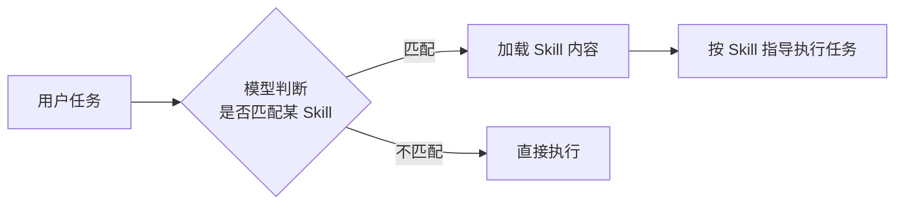
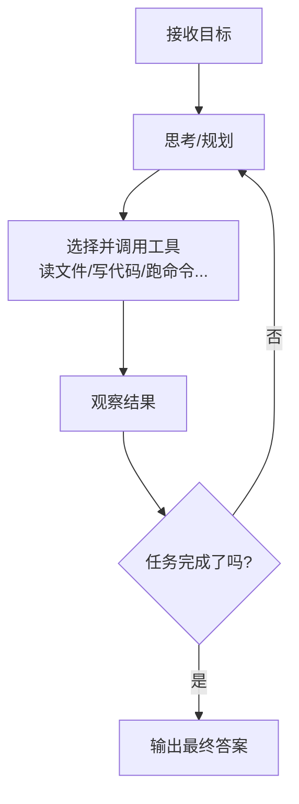
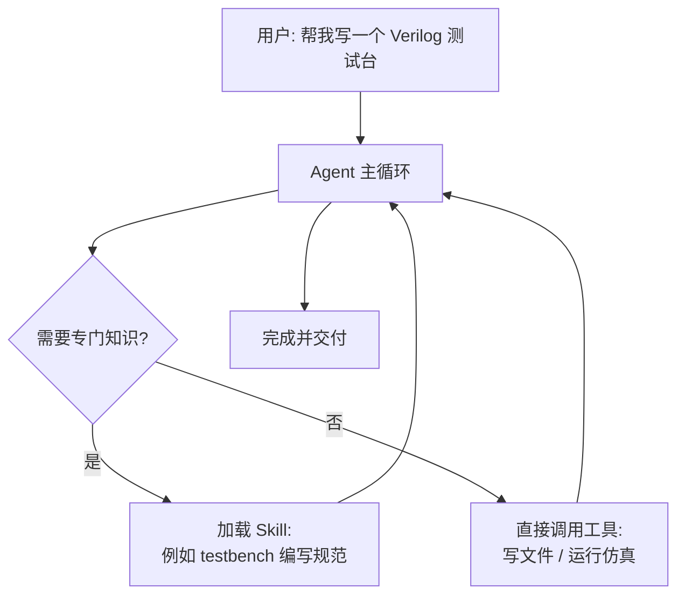

# Skill 与 Agent 简介

## 一句话理解

- **Skill（技能）**：一个**被动的能力包**，告诉模型"某件事该怎么做"，被调用时才生效。
- **Agent（智能体）**：一个**主动的执行者**，能自己规划、调用工具、多轮迭代直到完成任务。

---

## 什么是 Skill

Skill 通常是一份**结构化的知识/流程文档**（如 `SKILL.md`），包含：

- **元信息**：名称、描述（模型靠描述判断何时加载它）
- **操作指南**：做某类任务的最佳实践、步骤、注意事项
- **可选资源**：脚本、模板、参考文件

特点：

- **被动触发**：模型判断当前任务匹配时，才把 Skill 内容读入上下文
- **无自主行为**：它本身不做任何事，只是"说明书"
- **按需加载**：不占用上下文，直到需要时

> 类比：Skill 像**菜谱**——写好放在那，厨师（模型）做菜时才翻开看。

---

## 什么是 Agent

Agent 是一个**能自主完成任务的循环系统**，核心是一个循环：

特点：

- **自主性**：自己决定下一步做什么，而不是一步步等人指挥
- **工具使用**：可以读写文件、执行命令、搜索代码等
- **多轮迭代**：观察 → 思考 → 行动，反复循环直到达成目标

> 类比：Agent 像**一位实习生**——你给它一个目标，它自己查资料、动手、检查结果、不行再来。

---

## 差异对比

| 维度 | Skill | Agent |
|------|-------|-------|
| 本质 | 静态的知识文档 | 动态的运行实体 |
| 主动性 | 被动，等待被加载 | 主动，自行规划行动 |
| 是否执行任务 | 否，只提供指导 | 是，直接操作环境 |
| 生命周期 | 被读取一次即生效 | 持续循环直到任务完成 |
| 形态 | Markdown / 配置文件 | 模型 + 工具 + 循环框架 |

---

## 联系：两者如何协作

Skill 是 Agent 的"能力扩展包"。Agent 在循环中发现任务需要某领域知识时，加载对应 Skill 来指导自己的行动。

- **Agent 负责"怎么做事情"**（规划、执行、纠错）
- **Skill 负责"这类事情该怎么做"**（领域知识、流程规范）

---

## 在本课程实验中的体现

- `AGENTS.md` / `CLAUDE.md`：给 Agent 的行为约定（类似全局 Skill）
- 实验中的 Agent（如 Ralph）：按 PRD 自主完成 RTL 电路设计、仿真、修错的循环
- Skill 示例：可为"写 testbench""读仿真波形"等分别编写技能文档，供 Agent 按需加载